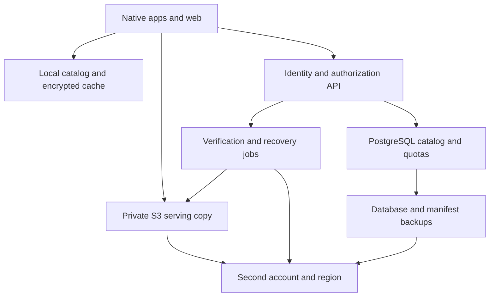

# Photo backup app product and engineering plan

Prepared for Rutvik Mehta on 16 September 2026

## Recommended direction

Build a private photo archive with a gallery that works from local cache, reliable background backup, safe device cleanup, and complete export. Store encrypted media on Amazon S3 in two geographically separate regions and separate AWS accounts. Keep the serving copy immediately accessible. Start with original quality and treat storage-saving conversion as a separate, explicitly lossy option.

Before building the whole system, spend two weeks evaluating Ente as the foundation. It already has open-source clients across the requested platforms, end-to-end encryption, background uploads, and export. Its repository uses AGPL-3.0; review the actual component licenses, redistribution obligations, hosted modifications, and branding before choosing a commercial fork. Do not assume a fork can remain proprietary. [Ente repository](https://github.com/ente/ente), [license](https://github.com/ente/ente/blob/main/LICENSE).

This plan describes the desired product, including features that must be validated or added to any existing foundation. It is not a claim that Ente already satisfies every requirement.

## Product boundaries and promises

The purpose is to let someone keep taking photos on a 128 GB phone without losing their originals or repeatedly buying larger devices.

Include JPEG, HEIC/HEIF, PNG, and supported RAW/DNG files. Preserve Live Photos and Android Motion Photos as compound photo assets, including their attached motion resources. Ordinary standalone videos, arbitrary documents, public sharing, editing suites, and server-side AI are outside the initial scope. Never silently drop the motion component of a photo.

Use camera-library selection and manual image imports rather than a generic file-drive interface. Camera origin cannot be proven reliably from EXIF. With end-to-end encryption, the server cannot inspect opaque uploads to conclusively enforce image-only content. Enforce supported formats in official clients, authenticated uploads, byte quotas, object limits, and abuse controls; do not claim cryptographic proof that every upload is a camera photo.

| Requirement | Product behavior | Necessary limit |
|---|---|---|
| Background backup | Discover new accessible photos and upload automatically when the OS permits | No guaranteed immediate upload while an iPhone app is suspended or force-quit |
| Original preservation | Downloaded originals match uploaded source bytes | Limited to resources and metadata the OS actually makes available |
| Quality selection | Original or explicit Storage Saver mode | Recompression cannot preserve all original image information |
| Instant return to gallery | Render cached catalog and previously viewed previews before networking | Evicted caches, logout, uninstall, and browser data clearing require fetching again |
| Whole-library export | Export photos, components, metadata, albums, and account data | A large export takes bandwidth, disk space, and time |
| Resumable transfer | Resume verified completed ranges or chunks | At most an unfinished chunk may need retransmission |
| Free up space | Delete eligible local resources after verification and confirmation | OS trash and other photo services affect when space is actually reclaimed |
| Owner-only viewing | Client-side encryption plus authorization | An unlocked compromised device or malicious client software remains a threat |
| Disaster survival | Independently recoverable copy in a second region and account | No credible service can promise survival of every possible catastrophe |

## Existing products and reuse decision

| Candidate | Fit | Decision |
|---|---|---|
| Ente | Closest existing open-source private photo product, with clients across mobile, desktop, and web | First evaluation candidate; audit S3 configuration, quality options, auth, transfer resume, and native UI requirements |
| Immich | Strong self-hosted photo-library reference; documented deployment is filesystem-oriented | Useful for UX and backup behavior research; do not base the S3 design on an unproven filesystem mount |
| Custom clients and service | Exact control over platform UX, billing, account recovery, and quality modes | Use if native UI or commercial requirements make reuse unsuitable; substantially more engineering |

The Immich recommendation is an architectural inference from its documented storage and deployment requirements, not a claim that no community S3 integration exists. [Immich requirements](https://docs.immich.app/install/requirements/).

Evaluation output: a running proof of concept with two real phones, Windows, macOS, Chrome, and Safari; a requirement gap list; license review; measured cost per imported GB; and a written fork-versus-custom decision. Inspect the selected release and pin its version rather than planning against an evolving main branch.

## Client and backend architecture

Interpret native strictly as platform-native applications. Recommended custom-build stack:

| Surface | Implementation | Responsibilities |
|---|---|---|
| iOS and macOS | Swift and SwiftUI with platform-specific adapters | PhotoKit, background transfers, Keychain, local gallery, cleanup |
| Android | Kotlin and Jetpack Compose | MediaStore, WorkManager, Keystore, gallery and cleanup |
| Windows | C# and WinUI 3 | Folder import, transfer queue, local gallery, secure credential storage |
| Web | TypeScript and Vue or React | Chrome/Safari gallery, manual upload, local decryption, export |
| Shared contracts | OpenAPI, common manifest format, crypto format and test vectors | Prevent incompatible clients and exports |
| API | Small Go service; retain the upstream backend if adopting Ente | Authorization, upload sessions, quotas, catalog sync, export jobs |
| Database | Managed PostgreSQL with point-in-time recovery | Ownership, opaque catalog records, subscriptions, transfer state |
| Jobs | SQS with bounded workers | Object verification, replication tracking, reconciliation and deletion |
| Media | Private S3, initially direct signed transfers | Encrypted photos, previews, thumbnails and recovery manifests |

An installed Flutter app can reduce duplicated UI work, but that is a deliberate alternative to platform-native UI. Electron/Tauri desktop shells are also a different interpretation of native. If Ente is adopted, assess its client implementations against the intended meaning before committing.

Keep media traffic off the API servers: clients upload and download directly through narrowly scoped signed access. The API handles small control messages. Start with a modular monolith; no Kubernetes or microservice fleet is required.

Use multi-AZ database availability for production and a recoverable deployment in the second region. A small private pilot may use cheaper infrastructure only while retaining original device copies and disabling cleanup.

## Quality and metadata preservation

**Original is the default.** Store source resources unchanged, then encrypt them. Never decode and re-encode the original simply to upload it. Keep original filenames inside encrypted metadata, not public object keys. S3's Last-Modified timestamp is not the camera capture time.

Generate two additional versions locally: a small grid thumbnail and a screen-sized preview. Starting targets are approximately 320–512 pixels for thumbnails and 1,600–2,048 pixels for previews, adjusted after visual and cost tests. These dimensions are proposed settings, not preservation copies. Browsing normally loads these derivatives; zoom, editing elsewhere, or explicit download can fetch the original.

**Storage Saver is opt-in.** Offer a tested preset such as a 12 MP ceiling with a controlled compression target. Show a before/after example and estimated space saving. Preserve available EXIF, IPTC, XMP, timestamps, orientation, location, ICC profiles and camera fields in supported embedded fields and an encrypted sidecar. Record original versus converted dimensions separately.

Unsupported MakerNotes, proprietary edit histories, RAW data, HDR gain maps, depth maps and auxiliary resources may not survive conversion or OS export. If a format cannot safely meet the supported metadata contract, retain the original or clearly mark it unsupported for conversion. Never advertise Storage Saver as fully equivalent to original preservation.

Persist the quality decision per asset. Changing the default affects future uploads only. A later upgrade to Original requires obtaining the original again; a compressed cloud copy cannot recreate it. Do not retain both full original and compressed archival copies while claiming storage savings.

For edited photos, preserve both the available original and the current rendered edit, plus adjustment resources where accessible. Preserve relationships between Live Photo stills and motion components. Store albums, favorites, captions, time-zone information and platform asset identifiers separately, because these may not be embedded in the image.

Use JPEG-compatible previews as the browser fallback so Safari and Chrome can browse files even when they cannot natively decode the original HEIC or RAW format. Reject neither a valid original nor its metadata merely because preview generation is unsupported; show an explicit preview-unavailable state.

## Backup workflow and reliability

Use a durable local queue and explicit states:

`Discovered → Preparing → Uploading → Verifying → Protected remotely → Eligible for cleanup`

Errors remain retryable records rather than silently disappearing. Show last successful backup, remaining photos and bytes, current quality, and actionable reasons such as permission denied, Wi-Fi required, device storage low, quota reached, or OS scheduling delay.

1. Discover accessible new assets using library changes plus periodic reconciliation. Default to camera photos; users can include additional albums or screenshots.
2. Record the source resource set, modification state and a local SHA-256 for the exact bytes. Detect same-account duplicates without exposing cross-user content hashes.
3. Reserve quota transactionally for originals, required components and allowed derivatives. Issue an upload session with server-chosen immutable object keys and expected sizes.
4. Generate previews and encrypt all payloads locally. Stage only a bounded number of resources so backup can work on an almost-full phone. Do not stage an entire camera roll.
5. Upload small files with a retryable single request; use multipart for larger resources or poor networks. Start with 8–16 MiB parts where appropriate, respecting S3 part-size rules.
6. Persist upload ID, completed part identifiers, byte lengths, checksums and retries. Reconcile with S3 before resuming. Refresh expired signed URLs for the same session.
7. Complete the upload on the server; verify expected bytes and an S3-supported checksum. Retain the original plaintext digest inside the encrypted manifest. ETags are version validators, not universal content hashes.
8. Persist the asset manifest, encrypted key envelope, catalog event and committed quota with an idempotent transaction/outbox pattern. Repeat callbacks must not create duplicate assets or double-charge storage.
9. Confirm the second-region object and recovery manifest exist with expected versions, sizes and checksums. Only then mark the asset Protected remotely.

Multipart uploads can retry failed parts independently, but abandoned parts keep accruing storage charges until completed or aborted. Set a proposed seven-day incomplete-upload expiry and tell the client when a session must restart. [S3 multipart behavior](https://docs.aws.amazon.com/AmazonS3/latest/userguide/mpuoverview.html). ETag behavior varies with upload and encryption method. [S3 metadata](https://docs.aws.amazon.com/AmazonS3/latest/userguide/UsingMetadata.html).

Use exponential backoff with jitter, bounded parallelism, a dead-letter queue and scheduled reconciliation. Handle the case where the object upload succeeds but the database commit fails. Garbage collection must use a grace period and cross-check manifests before removing an apparent orphan.

### Mobile background behavior

iOS: use PhotoKit to discover accessible resources, background URLSession for prepared file transfers, and BGProcessingTask for eligible discovery/preparation. Reconcile on foreground launch. Use newer continued-processing APIs only where available and appropriate to a user-started operation. Do not depend on a timer or silent push to run continuously. Apple determines background opportunities, and force-quit normally prevents background relaunch until the app is reopened. [Apple background execution limits](https://developer.apple.com/forums/thread/685525).

Android: use MediaStore and WorkManager with network, battery and retry constraints; select the appropriate user-visible transfer mechanism for long manual jobs. Jobs must recover across restart, while respecting force-stop, power restrictions and device-vendor behavior. [Android persistent work](https://developer.android.com/develop/background-work/background-tasks/persistent).

Full automatic library backup needs appropriate broad photo access. A limited selection grants access only to those items; a manual photo picker cannot guarantee future camera-roll discovery. For Android, verify the current Play photo-permission policy for a core photo-backup product. Handle location-metadata permissions and denial explicitly. [Android shared media access](https://developer.android.com/training/data-storage/shared/media).

For iCloud-optimized assets, retrieve the available original from iCloud through the OS before claiming original backup. If unavailable, keep the item pending. The first large backup should offer a guided Wi-Fi-and-power session with visible progress.

## Fast gallery and persistent caching

The gallery reads its local database first, restores scroll position, and paints cached thumbnails immediately after local unlock. Fetch catalog changes in the background through an incremental cursor; do not re-list S3 or download the whole catalog on every launch.

Use stable cache keys consisting of account ID, asset ID, variant and version. Never key cached images by a signed URL: its changing signature would create unnecessary misses. Cache encrypted bytes and decrypt locally. Keep decoded images briefly in memory.

Proposed mobile default: a 2 GB user-adjustable cache, divided between recent thumbnails and previews. Allow smaller limits for low-storage devices, and explicit offline pinning with its own visible storage budget. Evict least-recently-used unpinned previews before thumbnails. Do not delete pending originals or unfinished transfer state to satisfy the cache budget.

For the native apps, keep selected retained cache data in appropriate app-managed storage rather than assuming the OS cache directory is permanent. Exclude reproducible media caches from OS cloud backups. Wipe account caches and key access on logout; switching accounts must never expose another account's thumbnails.

Web: use IndexedDB for catalog/queue state and Cache Storage or OPFS for bounded encrypted payloads, with feature detection and persistence requests. Safari can evict site data under storage pressure or inactivity, so promise instant rendering when retained—not permanent offline storage in every browser. [WebKit storage policy](https://webkit.org/blog/14403/updates-to-storage-policy/).

Add CloudFront when measurements justify it. Use a private S3 origin, Origin Access Control, and authenticated viewer access. OAC protects the origin but does not itself authenticate the viewer. Only cache ciphertext under immutable paths; protect every requested object or narrowly scoped owner prefix. [CloudFront private S3 origin](https://docs.aws.amazon.com/AmazonCloudFront/latest/DeveloperGuide/private-content-restricting-access-to-s3.html).

## Complete resumable export

Export must remain available after cancellation through a clearly disclosed retention/grace period. Do not require an active paid plan merely to retrieve data still retained. Budget for ordinary exits as a service cost.

Create a versioned export manifest defining a snapshot of the library: photos in their backed-up quality, all companion resources, metadata sidecars, album memberships, favorites, captions, settings and relevant account records. Exclude provider secrets and authentication credentials. Clearly state when an asset exists only in Storage Saver quality.

The preferred large export is a native desktop downloader writing normal files into a chosen directory. Use safe filenames, resolve duplicates deterministically, preserve paths and dates where the destination supports them, and include a manifest and integrity report. Export should be usable without this app.

For each immutable remote version, persist received byte ranges/chunks to a partial file. On interruption or app restart, refresh authorization and request only missing ranges. Verify HTTP 206 and Content-Range; do not accidentally append a full HTTP 200 response. Verify final size, authenticated decryption and plaintext digest before atomically renaming to the final filename. S3 supports byte-range GET and version-specific retrieval. [S3 GetObject](https://docs.aws.amazon.com/AmazonS3/latest/API/API_GetObject.html).

Use a reviewed chunked authenticated-encryption format so a retry resumes at a verified encryption boundary. Reuse an existing proven protocol where possible; do not invent nonce management or a proprietary cipher. An unfinished chunk may be retried, but completed verified chunks and files are retained. This also bounds RAM use.

For Chrome and Safari, provide a resumable job with individually tracked files or modest independently downloadable batches. Client-side decryption and archive construction must remain bounded. Feature-detect direct file streaming; where unavailable, use small batches and ask the user to keep the tab open. Persist completed-file progress when browser storage survives. The desktop app is the reliable path for hundreds of GB, browser restarts, and limited disk quota.

Do not promise an uninterrupted browser job while the browser is closed. If equal restart-proof byte resume on every browser is mandatory, that requirement needs a native download helper or a different privacy design. A server cannot generate an ordinary plaintext ZIP when it does not possess the decryption keys.

No giant ZIP regeneration for each retry. Snapshot references must protect referenced objects from garbage collection for a finite disclosed period. An expired session should be extendable or resumable against still-retained versions, without discarding completed local downloads.

## Safely freeing device storage

Make this a separate explicit action. A missing local photo must never imply that the cloud backup should be deleted. Likewise, cloud trash should not silently delete the phone's copy.

Eligibility requires the current local revision to match the committed backup; every required companion resource, encrypted metadata record and recovery manifest must be present; both regional copies must be verified; and account recovery must have been set up. Any ambiguity blocks deletion.

Show a review screen with item count, estimated reclaimable bytes, backup quality, and exclusions. Revalidate eligibility immediately before requesting deletion through PhotoKit or Android's user-authorized media deletion APIs. Track partial approval and partial failure per item.

For Storage Saver assets, explicitly warn that removing the source may permanently discard original resolution or fidelity. Require separate acknowledgement. Default bulk cleanup to verified Original assets until the user deliberately enables compressed-backup cleanup.

Apple's iCloud Photos propagates deletion to other devices on the same account. Explain this before cleanup; retain the independent app backup. Items may remain in Recently Deleted for 30 days, so actual free space can lag. Guide users to the OS interface when necessary. [Apple deletion behavior](https://support.apple.com/en-us/104967).

Use the phrase safely remove backed-up photos. Do not claim forensic secure erasure of camera-roll files: an ordinary app cannot guarantee overwriting flash storage, OS backups, or another provider's copies. Keep recent previews so cleaned-up photos still appear in this app; they will not automatically remain in Apple Photos or another native gallery.

## Authentication and owner-only privacy

Offer email OTP, phone OTP, and passkeys, with passkeys encouraged after enrollment. Amazon Cognito is a viable managed option for a custom service; if adopting Ente, evaluate its identity and key model before replacing authentication. Cognito documents email/SMS OTP and WebAuthn flows. [Cognito authentication](https://docs.aws.amazon.com/cognito/latest/developerguide/authentication.html).

Keep one immutable internal user ID. Verified email and phone numbers are login methods, not object ownership keys. Do not auto-merge two libraries solely because an identifier appears to match. Require fresh authorization for account linking, recovery changes and destructive actions.

End-to-end encryption is recommended for the literal promise that only the owner can see photos. Encrypt originals, previews, thumbnails, filenames, GPS and descriptive metadata before upload. The server retains only the operational fields it needs, such as opaque IDs, ciphertext lengths, object versions and sync sequence numbers. Build chronological views from decrypted local metadata rather than leaking precise capture dates by default.

Use established encryption libraries and independently review the complete protocol. Each asset has a random data key wrapped by the user's vault key. Device secure storage protects the local vault key. Recovery uses a saved recovery key and/or a suitably protected vault passphrase, with trusted-device approval for new devices.

**Authentication and decryption are different.** Email/phone/passkey login establishes account access; it does not magically reconstruct an encryption key on a new device. Normal passkey signatures are not encryption secrets. Passkey-based key derivation must be validated across supported platforms, with a recovery-key fallback. Losing every authorized device and recovery method can make photos unrecoverable even though the S3 objects survive.

Mitigate web-client compromise with a strict CSP, no third-party analytics scripts in the vault, controlled releases, dependency review and secure update signing. E2EE does not protect content displayed by a compromised endpoint. Do not place plaintext photos, metadata or signed URLs in logs or crash reports.

## S3 security and disaster recovery

Use Block Public Access at account and bucket levels, disabled ACLs with bucket-owner-enforced ownership, TLS-only policies, server-side encryption, least-privilege roles, and audited administration. Never embed AWS access keys in clients. Authorize the owner before issuing access to an exact object/version. A random object name is not an authorization mechanism. [S3 security practices](https://docs.aws.amazon.com/AmazonS3/latest/userguide/security-best-practices.html).

Signed URLs are temporary bearer access. Keep lifetimes short enough to limit exposure but compatible with transfer scheduling, refresh after reauthorization, and never log them. E2EE means a leaked download URL alone exposes ciphertext, but it can still incur bandwidth cost.

For client-encrypted media, SSE-S3 is a reasonable baseline without per-request KMS fees. Use SSE-KMS where key-control requirements justify it, considering S3 Bucket Keys and cross-region key recovery. An operational administrator's ability to decrypt SSE-KMS is why server-side encryption alone does not satisfy provider-blind privacy.

**Recommended default protection:** a serving copy in Region A and a cross-account copy in Region B, both in immediately readable storage. Select the pair after deciding customer geography, residency expectations and regional pricing; do not put the disaster copy in the same region merely in another bucket. S3's multi-AZ durability is valuable but does not replace regional and administrative separation. [S3 durability and classes](https://aws.amazon.com/s3/faqs/).

Enable versioning, replicate immutable objects, and monitor lag/failures. Normal replication is asynchronous. Replication Time Control has an additional cost and targets 99.9% of new objects within 15 minutes; it is not synchronous protection. Cleanup should depend on the observed successful copy, not elapsed time. [S3 RTC](https://docs.aws.amazon.com/AmazonS3/latest/userguide/replication-time-control.html).

Use a proposed 30-day immutable recovery window, with Object Lock configured and tested on the recovery path. Design the required source/destination Object Lock and replication configuration together. Separate administrative credentials; the application role must not purge the recovery copy, change retention, or disable its keys. Evaluate governance versus compliance mode deliberately: compliance mode cannot be shortened even by the account root user. [Object Lock](https://docs.aws.amazon.com/AmazonS3/latest/userguide/object-lock.html).

Do not treat replication as historical backup. Define delete-marker behavior, lifecycle behavior, historical backfill, failed replication repair and eventual permanent deletion explicitly. Use a delayed controlled deletion job rather than blindly mirroring user deletion into recovery storage. [Replication scope](https://docs.aws.amazon.com/AmazonS3/latest/userguide/replication-what-is-isnot-replicated.html).

Back up PostgreSQL, encrypted key envelopes, ownership mappings, catalog events, asset manifests, infrastructure configuration and recovery runbooks. Keep independently reconstructible encrypted asset manifests in the second region so database loss cannot strand the media. Disaster recovery must include identity-provider disruption and re-establishing access without exposing vault keys.

Proposed targets to validate: no missing resources for assets labeled Protected remotely after loss of either region; metadata recovery within 15 minutes for noncritical recent changes; warm recovery service within four hours. These are design targets, not launch guarantees. Quarterly recovery drills must verify full client decryption and whole-library export, not merely bucket counts. Restore deletion tombstones too, so old backups do not resurrect deliberately deleted libraries.

A lower-cost disaster copy may use Glacier Deep Archive, but recovery then takes hours to days plus fleet transfer time and incurs restore fees. This is a separate service-level decision. Do not place the only serving original in delayed-restore storage while promising immediate download.

## Storage tiers and billing safeguards

Keep thumbnails and frequently used previews in S3 Standard. Start serving originals in Standard; benchmark Intelligent-Tiering for sufficiently large objects after observing access patterns. Keep its optional asynchronous archive tiers off for serving data. It has per-object monitoring considerations; objects below 128 KB do not auto-tier. [Intelligent-Tiering behavior](https://docs.aws.amazon.com/AmazonS3/latest/userguide/intelligent-tiering-overview.html).

Evaluate Standard-IA and Glacier Instant Retrieval with actual export/retrieval patterns rather than choosing the lowest GB price. Minimum retention, small-object overhead, transitions, retrieval and early-deletion fees matter. Do not use a single-AZ class as the only preservation copy. [AWS S3 pricing and charging rules](https://aws.amazon.com/s3/pricing/).

Cost controls must operate inside the product:

- Reserve storage before issuing uploads; limit object count, size, derivative ratios and concurrent sessions. Reconcile actual object usage, versions, incomplete uploads and quota records.
- Enforce declared upload bounds with the appropriate signed request or POST policy and verify actual sizes. A completed session must not leave a reusable write grant capable of accumulating unlimited versions.
- Keep a real-time transfer ledger, constrain signed access to small batches, and limit concurrent export jobs. Signed URLs may be replayed during their validity, so they are not a perfect byte cap; use stricter authenticated delivery when required.
- Bound worker concurrency, retries, server autoscaling and log retention. Avoid media passing through NAT gateways or application servers. Use appropriate S3 endpoints for private AWS workloads.
- Rate-limit email/SMS by destination, account, device and IP; cap supported SMS destinations and use fraud controls. Phone OTP abuse is a billing risk even before photos are uploaded.
- Track per-user stored GB, downloaded GB, object count and estimated cost. Alert on abnormal growth and repeated downloads. Reuse cached previews and never repeatedly process unchanged images.
- Add AWS Budgets and Cost Anomaly Detection. They are delayed signals, not hard spending ceilings; application-level safeguards are still required. [AWS Budgets delay](https://docs.aws.amazon.com/cost-management/latest/userguide/budgets-managing-costs.html).
- On a cost incident, pause suspicious new uploads and expensive optional work first. Preserve stored data and a controlled legitimate export path. Never delete customers' photos as an automatic cost response.

Unlimited free downloads plus AWS egress cannot produce a mathematically fixed maximum bill. Offer export at any time, price a realistic export allowance into the subscription, and disclose rate limits or repeated-export terms before purchase. Slowing downloads changes timing, not total transfer cost. If unrestricted repeated full-speed exports are mandatory, accept the variable cost or revisit the delivery economics.

## Illustrative unit economics

These are planning assumptions, not a verified AWS quote. The public pricing page's live regional rate table was not available as readable text during research. Replace every assumed rate with an AWS Calculator estimate for the chosen regions and delivery route before setting prices. No free tier, discount, tax, exchange rate or negotiated transfer benefit is assumed.

Assume one fully used 100 GB account and 5 GB of previews/metadata; two warm copies of all 105 GB. Illustrative storage rate: $0.025 per GB-month in each region. Illustrative effective internet-delivery rate: $0.10 per GB. Illustrative cross-region replication transfer rate: $0.02 per new GB. These rounded modeling inputs are not ceilings and may differ materially from actual rates.

| Scenario or line item | Calculation | Illustrative cost |
|---|---|---:|
| Primary storage | 105 GB × $0.025 | $2.625/month |
| Warm recovery copy | 105 GB × $0.025 | $2.625/month |
| Combined warm storage | 210 GB × $0.025 | $5.25/month |
| Typical browsing assumption | 5 GB delivered × $0.10 | $0.50/month |
| Full export of 100 GB of photos | 100 GB × $0.10 | $10.00/export |
| Initial replication transfer | 105 GB × $0.02 | $2.10 once at import |
| 1,000 similarly full accounts | 1,000 × $5.25 | $5,250/month for storage only |
| All 1,000 users export once | 1,000 × $10 | $10,000 additional delivery |

Add API/GET/PUT/replication requests, database, compute, monitoring, identity, SMS, version/trash retention, Object Lock retention, support, payment processing, app-store charges where applicable, and tax. Include additional storage and retransmission overhead from the actual encryption format.

For comparison only: retaining a 100 GB disaster original in archive at an assumed $0.0012/GB-month, while keeping 5 GB recovery metadata/previews warm, would make total storage roughly $2.87/month per account. That excludes archive metadata, requests, minimum-duration charges, restore costs and restore delay. It is a durability option, not equivalent availability.

Build the revenue model using actual occupied storage as well as worst-case plan occupancy. Formula:

`monthly service cost = storage copies + retained versions + delivered bytes + replication + requests + allocated platform cost + support`

For an illustrative 60% gross-margin target, revenue before taxes and applicable sales fees must be at least `service cost / 0.40`. Even the $5.75 warm-storage-plus-browsing subtotal implies $14.38 before the other costs. Include a reserve for one complete exit export in acquisition/lifetime economics. Do not launch lifetime or unlimited-storage plans based on unused quota.

## Data model and API boundaries

Core entities: User, LoginIdentity, Device, Library, Asset, AssetResource, EncryptedMetadata, UploadSession, TransferPart, ReplicationStatus, ExportSnapshot, ExportProgress, QuotaReservation, Subscription, Tombstone and AuditEvent.

Store each resource's opaque object key, immutable version, ciphertext size/checksum, encryption-format version, source device reference and protection status. Keep plaintext content digests and photo metadata inside the encrypted payload. Relate companion resources to one asset so half a Live Photo cannot be marked complete.

Expose separate operations for upload initiation/completion, sync changes, authorized resource access, cleanup eligibility, export snapshots, cloud trash and account deletion. Enforce ownership on every operation—including progress callbacks, thumbnail access, range downloads, export metadata and restore requests. The frontend never selects an arbitrary S3 key or another owner's prefix.

Use idempotency keys and server-generated asset IDs. Local-only removal changes the device mapping; cloud deletion creates a tombstone. Add a proposed 30-day user-visible cloud trash window and document the later permanent purge schedule, including any immutable backup delay. Cancellation, inactivity and payment failure must not cause immediate irreversible deletion.

## Delivery roadmap

The following is a rough planning estimate for a dedicated team, not a fixed bid. A solo developer should narrow the release order; building five polished surfaces and a recovery service is not a short side project.

| Phase | Indicative time | Exit evidence |
|---|---|---|
| Foundation evaluation | 2 weeks | Ente gap/license assessment, native requirement decision, real-device background and recovery prototypes |
| Preservation foundation | 4–6 weeks | Identity and vault recovery, Original upload, manifests, private S3, cross-region verification, complete export |
| Mobile experience | 6–8 weeks | iOS and Android background queue, retained cache, quality settings and permission handling |
| Desktop and web completion | 4–6 weeks, partially overlapping | Windows/macOS imports and resumable exports; Chrome/Safari compatibility |
| Trust and launch gates | 4–6 weeks | Cleanup enabled only after independent review, recovery drill, abuse/cost tests and paid beta |

Allow roughly five to eight months for a custom production release with an experienced small team, then revise after the two-week spike. Reuse can shorten implementation but does not remove security, platform QA or disaster-recovery work. Cover backend/infrastructure, Apple platforms, Android/Windows, web, and QA/security with named owners; parallel roles require sufficient staffing.

Release Original backup first. Add Storage Saver only after metadata and image-quality fixtures pass. Enable cleanup last, after successful restore drills. A limited first release can launch on iOS, Android and web while native desktop remains in private beta, but full requested scope is not complete until Windows and macOS pass the same preservation gates.

## Acceptance gates

| Area | Required test |
|---|---|
| Original fidelity | Byte-identical round-trip on JPEG, HEIC, PNG, DNG and every supported companion resource |
| Metadata | Capture dates/time zones, GPS permissions, orientation, color profiles, edits and Live/Motion Photo pairing verified |
| Lossy quality | Compare representative daylight, night, portrait, HDR, text and RAW samples; validate sidecars and fallback to Original |
| Transfer resume | Cut network repeatedly, expire credentials, restart app/device, fill disk and change network; completed chunks retained |
| Safe cleanup | Reject partial upload, stale local revision, absent replica, missing sidecar and failed key recovery; handle denied deletion |
| Background backup | Real devices with locked screen, low power, revoked access, limited library, force-stop/force-quit and Wi-Fi changes |
| Gallery | Reopen offline with retained cache; target cached first gallery under one second on agreed reference devices after unlock |
| Large library | Test 100,000 assets and a 100 GB export without full-library memory loading or duplicate downloads |
| Tenant isolation | Another account cannot read originals, previews, metadata, export ranges, jobs or guessed identifiers |
| Recovery | Lose primary region and database; rebuild and decrypt selected full libraries from independent recovery assets |
| Account loss | Prove trusted-device enrollment and recovery-key restore; explain irrecoverable-key cases before cleanup |
| Browser limits | Chrome and Safari quota eviction, refresh, tab suspension, file reselection, interrupted batches and expired access |
| Billing attack | Repeated OTP, signed-URL replay, oversized uploads, abandoned multipart sessions, retry loops and repeated exports |
| Deletion | Tombstones survive restoration; local cleanup cannot trigger cloud deletion; permanent purge respects the disclosed policy |

Launch only when measured costs support the proposed subscription, recovery works with real encrypted photos, and the user can understand exactly when a photo is safe to remove from the phone.

## Decisions to settle after the evaluation

1. Ente-based product or independent native clients, including the licensing and maintenance commitment.
2. Target customer geography and the primary/recovery AWS region pair.
3. Warm disaster recovery by default or cheaper delayed recovery with a disclosed service target.
4. Storage Saver's accepted losses, supported formats, and whether cleanup may remove originals after conversion.
5. Subscription limits and export funding, based on observed occupancy and retrieval behavior.
6. Recovery experience: saved recovery key, vault passphrase, trusted-device enrollment, and cross-platform passkey support.

Recommended starting decisions: Original by default; end-to-end encryption; two warm regional copies; recovery setup before cleanup; bounded persistent caches; complete native export; and a two-week Ente evaluation before committing to a fresh implementation.
